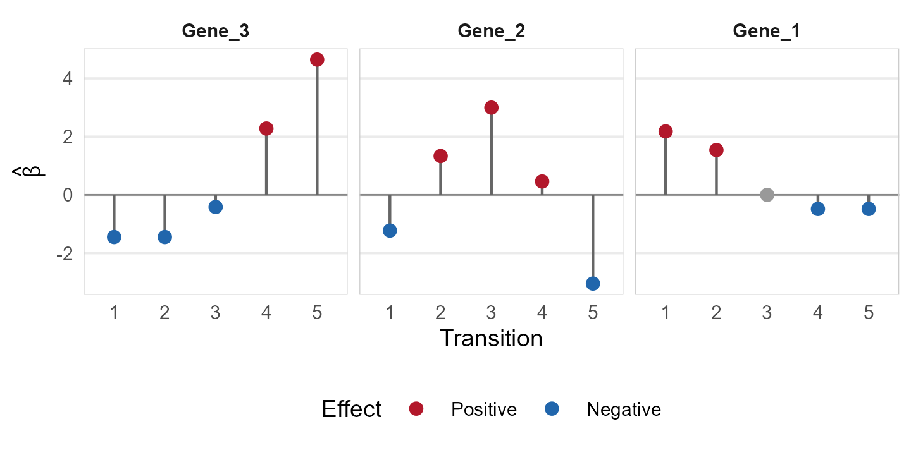
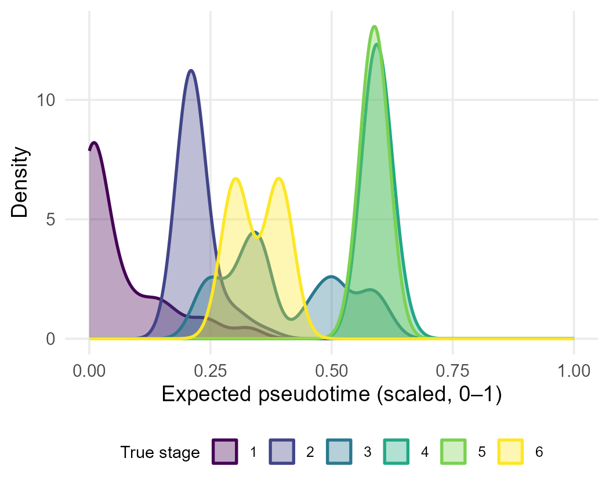

# fusedFCR

**fusedFCR** fits a penalized forward continuation-ratio (FCR) model for ordinal outcomes such as developmental stages or time points. A lasso penalty selects genes, and a fused penalty smooths each gene's effect across adjacent transitions, so the model finds which genes drive which stage transitions. Tuning is by cross-validation over both penalties.

## Installation

```r
# install.packages("remotes")
remotes::install_github("anirban0451/fusedFCR")
```

The package includes C++ code that is compiled during installation. This requires [Rtools](https://cran.r-project.org/bin/windows/Rtools/) on Windows or the Xcode command-line tools on macOS (`xcode-select --install`).

## Example: a small temporal simulation

Simulate 600 cells across 6 stages with 20 genes. Genes 1, 2, and 3 are early, transient, and late markers whose effects change across the 5 transitions; the remaining genes are noise.

```r
library(fusedFCR)

sim <- generate_sim_data(N = 600, P = 20, time_varying = TRUE, seed = 2026)

# 80/20 train/test split
set.seed(1)
train <- sample(nrow(sim$X), 480)
X_train <- sim$X[train, ]
Y_train <- sim$Y[train]
X_test <- sim$X[-train, ]
Y_test <- sim$Y[-train]
```

Choose the two penalties by 5-fold cross-validation, then fit the final model:

```r
grid <- c(0.005, 0.01, 0.02, 0.05, 0.1)
cv <- cv_ISTA_sequential(X_train, Y_train, lambda1_grid = grid, lambda2_grid = grid, K_folds = 5)
best <- extract_optimal_lambdas(cv$cv_results, criterion = "sparsity")
fit <- run_FCR_ISTA(X_train, Y_train, lambda1 = best$lambda1, lambda2 = best$lambda2)
```

For larger grids, `cv_ISTA_parallel()` runs the same cross-validation across multiple cores.

### Selected genes

`select_genes()` keeps genes whose coefficient exceeds a threshold at any transition, ordered by effect size. Here it recovers exactly the three true markers:

```r
select_genes(fit, threshold = 0.1)
#>         Time_1  Time_2  Time_3  Time_4  Time_5
#> Gene_3 -1.4459 -1.4459 -0.4149  2.2788  4.6455
#> Gene_2 -1.2246  1.3348  2.9968  0.4613 -3.0439
#> Gene_1  2.1806  1.5402  0.0000 -0.4824 -0.4824
```

`plot_lollipop()` shows each selected gene's effect at every transition, with up to six panels per row (`top_n = 10` gives two rows):
  
  ```r
plot_lollipop(fit, threshold = 0.05, top_n = 3)
```



The early marker (Gene_1) drives the first transitions, the transient marker (Gene_2) peaks at transition 3, and the late marker (Gene_3) drives the final transitions.

### Predicted pseudotime on held-out cells

`pseudotime_FCR()` predicts stage probabilities and the expected pseudotime (scaled to 0–1) for new cells. `plot_pseudotime_density()` shows how well the predicted ordering separates the true stages:
  
  ```r
pt <- pseudotime_FCR(fit, X_test, threshold = 0.1)
mean(pt$pred_class == Y_test)   # test accuracy
#> [1] 0.883

plot_pseudotime_density(pt, true_stage = Y_test, bw = 0.03)
```



Both plotting functions take a `file` argument (for example `file = "lollipop.pdf"`) to save the figure; the lollipop figure's height grows with the number of panel rows. Also, note that for the density plots, the shape of the density curves depends on the smoothing bandwidth (bw).

## Using your own data

Pass a cells × genes expression matrix `X` (for example, log-normalized counts of highly variable genes) and an integer stage vector `Y` coded `1, 2, ..., T`. Use `transition_labels` in `plot_lollipop()` and `y_levels` in `pseudotime_FCR()` to label real stages or time points, such as differentiation day or collection day.
